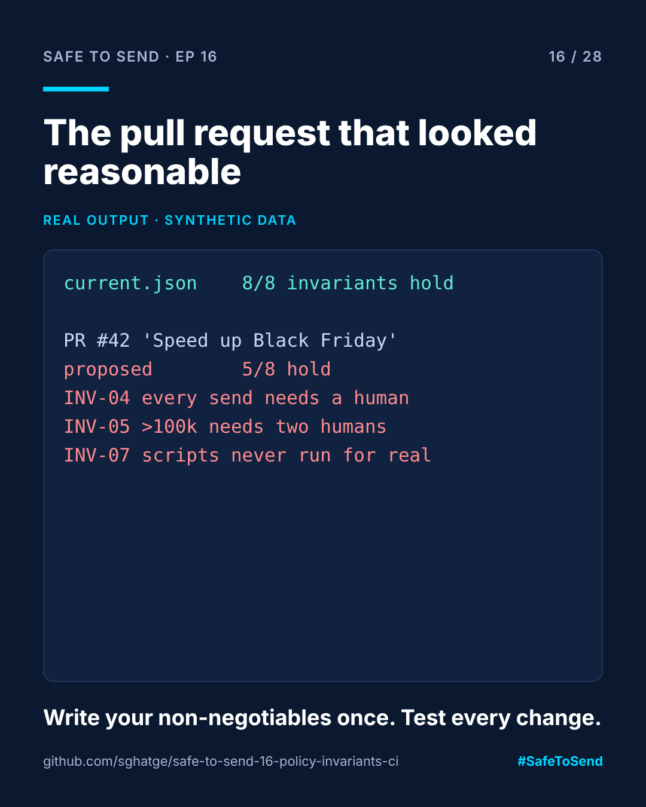

<div align="center">


**SAFE TO SEND · GOVERNED AI ENGINEERING SERIES · SAFE TO SEND 16 POLICY INVARIANTS CI**

[GitHub Profile](https://github.com/sghatge) · [Portfolio](https://sghatge.github.io/adobe-campaign-v8-governance/)

</div>

---

# safe-to-send-16 · Policy Invariants in CI



**Safe to Send · Episode 16** — a 28-day learn-in-public series on governing AI in CRM operations.

> If a one-line policy change can let an agent write to your database, that change needs a test before it merges.

## The real-world scenario

Black Friday is close. Someone opens a pull request titled "Speed up Black Friday: let the agent send small campaigns and run cleanup scripts". It changes four lines of policy. Reviewers are busy. It looks reasonable.

## The use case

Write your non-negotiables once, as **invariants**: a test call plus the decisions that are acceptable for it. CI checks every policy change against all of them and fails the pull request, naming each rule that broke.

## Run it

```bash
python invariants.py policies/current.json
python invariants.py policies/proposed_speedup.json
```

## Real example output

```
policies/current.json: 8/8 invariants hold

policies/proposed_speedup.json: 5/8 invariants hold
  BROKEN INV-04: Every send needs a human (policy now says 'allow')
  BROKEN INV-05: Sends above 100,000 need two humans (policy now says 'needs_approval')
  BROKEN INV-07: Server-side scripts never execute for real (policy now says 'allow')
```

The "speed-up" quietly removed human approval from every send under 50,000 recipients, lowered a 200,000 send to one approver, and let scripts run for real. Three lines in a diff. Three named failures in CI.

## Included

- `invariants.json` — eight starter invariants for Adobe Campaign agents
- `.github/workflows/tests.yml` — runs the unit tests and checks the live policy on every push and pull request

MIT · [Sangram Ghatge](https://www.linkedin.com/in/sangram-g-2369705b) · #SafeToSend
